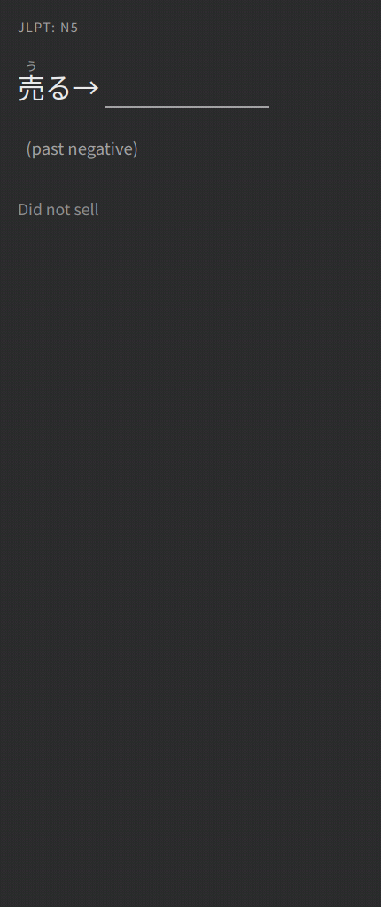
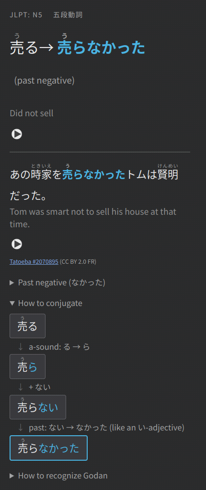

# Ultimate-Crunch

An Anki deck to drill Japanese verb conjugation: about 600 JLPT N5–N3 verbs and 30 forms, organized by JLPT level.

Each card shows a verb in its dictionary form and asks for one conjugation:

<p align="center">
  
  &nbsp;
  
</p>
<p align="center"><em>Example card: front (left) and back (right)</em></p>

---

## Disclaimer

I'm **not** a Japanese teacher or a native speaker, just a learner (at beginner level nonetheless) who built this deck for my own study.
Most of the deck is **generated by scripts**, not written by hand, so expect some mistakes:

- **Conjugations** are computed from the verb class, with rules for the irregular verbs (する, 来る, 行く, ある, いらっしゃる, ...). A rule that is wrong for one verb is wrong on all its cards.
- **English translations** come from a short dictionary gloss plus a template ("Does not {verb}"), so they can sound stiff or miss the nuance of a verb.
- **Example sentences** are matched automatically from Tatoeba, a volunteer project.
- **Audio** for the answers is synthetic speech (see [Audio](#audio)).

The translations on the cards have no subject: 食[た]べた is "Ate", not "I ate"; 食[た]べない is "Does not eat", not "He doesn't eat".
That is on purpose. As [Tae Kim's Guide to Japanese](https://guidetojapanese.org/learn/grammar/verbs) puts it:

> A grammatically complete sentence requires a verb only (including state-of-being). [...] unlike English, the only thing you need to make a grammatically complete sentence is a verb and nothing else! That's why even the simplest, most basic Japanese sentence cannot be translated into English!
>
> 食べる。 Eat. (possible translations include: I eat/she eats/they eat)
>
> — Tae Kim, *A Guide to Japanese Grammar*, "Verb Basics"

Adding "I", "it" or "you" would add information that is not in the Japanese, so the cards leave it out.
The exceptions are a few forms that read badly in English without one, where the subject is added in parentheses: the conditionals "If (one) eats", the causative "Make/let (someone) eat" and the humble form "(I) eat (humble)".
The example sentences are different: they are full sentences translated by Tatoeba contributors, and keep their pronouns.

If you find an error, please [open an issue](../../issues) or a pull request. Corrections are very welcome!

---

## Download

- [AnkiWeb](https://ankiweb.net/shared/info/2103052727)

---

## Contents

| Level | Verbs | Forms |
|-------|-------|-------|
| N5 | 108 | ます, ません, ました, ませんでした, ましょう; ない, た, なかった; て-form, ている, てください, ないでください, たい |
| N4 | 141 | potential (and its negative), volitional, ば and たら conditionals, なければならない, たり, ながら, command, prohibition, passive, causative, honorific and humble (keigo) |
| N3 | 347 | causative-passive, ずに |

Cards are tagged `UC::N5`, `UC::form::nai`, `UC::verb::N4`, `UC::type::godan`, ... so you can filter or suspend by level, form or verb type.
The verb type is also in the `VerbType` field and shown on the back of the card (see [Verb types](#verb-types)).

---

## Verb types

Japanese verbs fall into three groups, and the group decides how a verb conjugates:

| Type | On the card | Verbs |
|------|-------------|-------|
| Ichidan | 一段動詞 | 197 |
| Godan | 五段動詞 | 395 |
| Irregular (Fukisoku) | 不規則動詞 | 4 |

**How the deck tells them apart.** It comes from each verb's class in [JMdict](https://www.edrdg.org/jmdict/j_jmdict.html), stored in the `class` column of [`data/verbs.tsv`](data/verbs.tsv):

- `v1` → ichidan
- `v5u`, `v5k`, `v5g`, `v5s`, `v5t`, `v5n`, `v5b`, `v5m`, `v5r` → godan (by ending)
- `vk` (来る), `vs-i` (する, 勉強する) → irregular

---

## Sources

| Source | What it gives | License |
|--------|---------------|---------|
| [open-anki-jlpt-decks](https://github.com/jamsinclair/open-anki-jlpt-decks), via [jlpt-anki-decks](https://github.com/chyyran/jlpt-anki-decks), from the lists by Jonathan Waller at tanos.co.uk | JLPT level, spelling, reading, English gloss | MIT; WTFPL; CC BY (tanos, see below) |
| [JMdict](https://www.edrdg.org/jmdict/j_jmdict.html) via [jmdict-simplified](https://github.com/scriptin/jmdict-simplified) | verb class (る/う/irregular), transitivity | CC BY-SA 4.0 |
| [Tatoeba](https://tatoeba.org) | example sentences, translations, recordings | CC BY 2.0 FR (recordings: per contributor) |

Each example sentence (on the card and in the explanations in [`notes/`](notes/)) links back to its Tatoeba page; recorded audio is credited with its author and license on the card.

The JLPT word lists go back to Jonathan Waller's tanos.co.uk, the long-standing reference for JLPT vocabulary. The site is no longer online; to the best of our knowledge its lists were shared under a Creative Commons Attribution (CC BY) license, and all credit for them goes to their author.

### Audio

- **Answer**: synthetic speech, generated with Microsoft's Japanese neural voices through [edge-tts](https://github.com/rany2/edge-tts). Pronunciation and pitch accent are usually good but can occasionally be wrong.
- **Example sentence**: the Tatoeba recording when one exists under a reusable license, otherwise edge-tts.

---

## How the deck is built

Everything is generated from the files in [`data/`](data/) by the scripts in [`script/`](script/), and sent to Anki through [AnkiConnect](https://ankiweb.net/shared/info/2055492159).

```
pip install -e .
```

1. **`script/download.sh`**: downloads the raw sources into `data/raw/` (about 200 MB, not committed).
2. **`script/build_verbs.py`**: builds [`data/verbs.tsv`](data/verbs.tsv), the list of verbs with their level, reading, class and English.
   The TSV is meant to be **edited by hand** afterwards (fix a gloss, drop a verb, change a level). Rerunning the script overwrites it.
3. **`script/build_examples.py`**: finds a Tatoeba sentence for every (verb, form) pair and writes [`data/examples.json`](data/examples.json).
   A sentence matches only if it contains the exact conjugated form (食べない matches 「もう食べない。」 but not 「食べないで」). To drop a bad example, delete its entry or add `"skip": true`.
4. **`script/push_notes.py --apply`** (Anki must be running): creates or updates the note type, the deck and the notes. Without `--apply` it is a dry run.
   Rerunning only updates notes whose content changed; notes that are no longer generated are listed, never deleted.
5. **`script/add_audio.py --apply`**: adds the audio to the notes. Clips are stored once, so rerunning only creates what is missing.
6. **`script/push_explanations.py --apply`**: copies the explanations in [`notes/`](notes/) into the `Explanation` field, shown collapsed on the back (one section per note, titled by its `# title` line).
   A note named after a form goes on that form's cards automatically: `notes/n5-masu.md` → every ます card (the key is the form's name in `script/conjugate.py`, the prefix its JLPT level).
   Images (the flowcharts in [`tex/`](tex/), compiled to SVG) are uploaded to Anki's media folder. Edit the files, never the field.

The conjugation rules and the list of forms live in [`script/conjugate.py`](script/conjugate.py): to add or remove a form, edit `FORMS` there and push again.

The "How to conjugate" section on the back (dictionary form → stem → what to add, as boxes and arrows) is generated by [`script/steps.py`](script/steps.py) and filled in by `push_notes.py`. `python script/steps.py 売る nakatta` prints a chain, `--html` the card HTML, and `--check` verifies that every chain ends on the right conjugation.

The "How to recognize" section (the ichidan / godan / irregular flowchart, with the card's verb's path highlighted, and the table of exceptions from [`notes/n5-verbclassification.md`](notes/n5-verbclassification.md)) is generated the same way by [`script/recognize.py`](script/recognize.py): `python script/recognize.py 帰る` prints the path.

### Card format

Each note has a `Sentence` field with the answer between `#` markers, plus the indication and the English:

```
Sentence:     食[た]べる→ #食[た]べない#
SentenceMod:  negative
Translation:  Does not eat
```

The front shows `#…#` as an underlined blank exactly as wide as the answer (so the card wraps the same on both sides); the back shows it in the accent color.
The templates and CSS are in [`templates/`](templates/) and are copied into Anki by `push_notes.py --apply`.

---

## Changing the accent color

The answer on the back of the card (and any bold text) uses an accent color, light blue by default.
It is set once at the top of [`templates/style.css`](templates/style.css):

```css
:root {
  --accent: #4fc3f7;    /* light blue (default) */
  /* --accent: #ff8c00; */  /* orange */
  /* --accent: #10b981; */  /* emerald green */
  /* --accent: #f87171; */  /* soft red */
  /* --accent: #facc15; */  /* golden yellow */
}
```

Comment out the active line and uncomment the one you want (or put in any color you like), then run `python script/push_notes.py --apply`.

If you just downloaded the deck, edit the same block directly in Anki: it is at the top of the note type's styling
(Tools > Manage Note Types > Crunch Fill > Cards > Styling).

---

## Contributing

Found a wrong conjugation, a bad example sentence or a missing verb? Open an issue or a pull request.

## TODO

* Release
