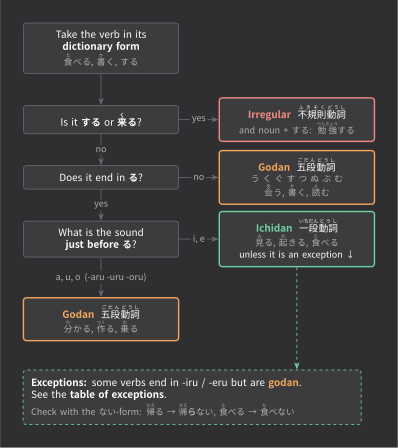

# Verb types: ichidan, godan or irregular

#### Table of exceptions: -iru / -eru verbs that are godan

| Level | Verbs |
|-------|-------|
| N5 | 帰[かえ]る, 入[はい]る, 走[はし]る, 知[し]る, 切[き]る, 要[い]る |
| N4 | 滑[すべ]る |
| N3 | 限[かぎ]る, 握[にぎ]る, 減[へ]る, 散[ち]る, 蹴[け]る, 湿[しめ]る, 混[ま]じる, 返[かえ]る, しゃべる, 裏切[うらぎ]る, 横切[よこぎ]る, 気[き]に入[い]る |
